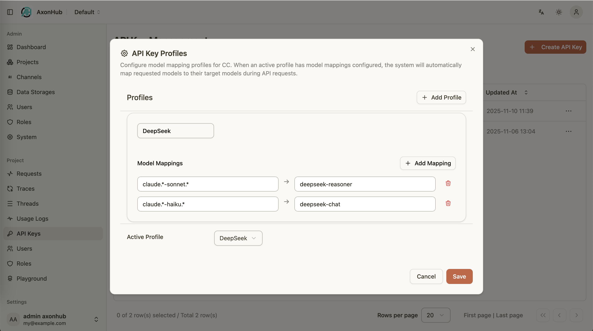

# Claude Code 集成指南

---

## 概览
AxonHub 可以作为 Anthropic 接口的直接替代方案，使 Claude Code 能够通过您自己的基础设施连接。本文将介绍配置方法，并说明如何结合 AxonHub 的模型配置文件功能实现灵活路由。

### 关键点
- AxonHub 支持多种 AI 协议/格式转换。你可以配置多个上游渠道（provider/channel），对外提供统一的 Anthropic 兼容接口，供 Claude Code 使用。
- 你可以开启 Claude Code trace 聚合，将 Claude Code 同一次会话中的请求自动归并到同一条 Trace（见"配置 Claude Code"）。

对于初始输入用量缺失或为零、且未报告缓存用量的 Anthropic 流式响应，AxonHub 使用 `o200k_base` 对请求文本和工具定义估算输入 token，并填入 `message_start`，帮助 Claude Code 在上游最终用量到达前显示进度，无需缓冲完整响应。估算不包含编码图片、音频和控制元数据，因此并非精确用量。上游最终用量保持不变，仍是持久化用量及费用核算的依据；初始估算仅应用于发送给客户端的流。

### 前置要求
- 可访问的 AxonHub 实例。
- 拥有项目访问权限的 AxonHub API Key。
- Claude Code（Anthropic）的使用权限。
- （可选）已在 AxonHub 控制台配置好的一个或多个模型配置文件。

### 配置 Claude Code
1. 在 Shell 环境变量中写入 AxonHub 凭证：
   ```bash
   export ANTHROPIC_AUTH_TOKEN="<your-axonhub-api-key>"
   export ANTHROPIC_BASE_URL="http://localhost:8090/anthropic"
   # 或者使用根路径：
   # export ANTHROPIC_BASE_URL="http://localhost:8090"
   ```
2. 启动 Claude Code，程序会自动读取上述变量并将所有 Anthropic 请求代理到 AxonHub。
3. （可选）触发一次对话并在 AxonHub 的 Traces 页面确认流量已成功记录。

#### Trace 聚合（重要）
若希望将 Claude Code 同一次会话的请求聚合到同一条 Trace，可在 `config.yml` 中开启：

```yaml
server:
  trace:
    claude_code_trace_enabled: true
```

**提示**：开启此功能后，AxonHub 会将同一个 Trace 的请求优先转发到同一个上游渠道，从而大幅提高提供商端的缓存命中率（例如 Anthropic 的 Prompt Caching）。

#### 提示
- 请务必保密 API Key，可写入 shell profile 或使用密钥管理工具。
- 若 AxonHub 使用自签名证书，请在操作系统内添加信任配置。

### 服务端自动模式审查模型

AxonHub 可以使用独立模型审查 Claude Code 自动模式提出的工具调用。此功能默认关闭，与主对话模型相互独立。请先配置提供审查模型的渠道，并允许调用方 API Key 及项目访问该模型。例如，通过 Codex 渠道使用 `codex-auto-review`，并在另一个渠道配置 `gemini-3.8-flash` 作为备用：

```yaml
server:
  safeguards:
    classifier_model: codex-auto-review
    fallback_models: [gemini-3.8-flash]
    escalate_on_denial: false
    attempt_timeout: 10s
    timeout: 30s
    max_tokens: 4096
    transcript_char_budget: 24000
```

修改后需重启 AxonHub；SIGHUP 不会重新加载这些设置。对应环境变量如下：

```bash
export AXONHUB_SERVER_SAFEGUARDS_CLASSIFIER_MODEL="codex-auto-review"
export AXONHUB_SERVER_SAFEGUARDS_FALLBACK_MODELS='["gemini-3.8-flash"]'
export AXONHUB_SERVER_SAFEGUARDS_ATTEMPT_TIMEOUT="10s"
export AXONHUB_SERVER_SAFEGUARDS_TIMEOUT="30s"
export AXONHUB_SERVER_SAFEGUARDS_MAX_TOKENS="4096"
export AXONHUB_SERVER_SAFEGUARDS_TRANSCRIPT_CHAR_BUDGET="24000"
```

在支持服务端自动模式的 Claude Code 版本中启用服务端选项并选择自动模式：

```bash
export CLAUDE_CODE_AUTO_MODE_SERVER=1
claude --permission-mode auto
```

请求必须包含 `dangerous_tool_use` 防护设置。AxonHub 自行构造审查请求，评估主模型提出的工具调用，并返回以工具调用 ID 为键的 `safeguard_results`（位于响应对象中，流式响应则位于最终的消息增量中）。审查模型由服务端选择，不接受客户端指定的审查模型配置。未启用该防护的普通请求不会触发审查模型调用。

每次审查尝试都会增加一次模型请求及相应的 token 成本。审查请求沿用调用方的项目与模型访问限制。审查模型没有工具，不能执行被审查的命令。审查请求遵循已配置的通道重试策略；`attempt_timeout` 限制每个模型尝试（包含通道重试），`timeout` 则限制跨所有模型的整个审查过程。重试可能增加 token 成本。建议选择能力合适、成本较低的模型，观察判定和超时情况，并优先调整对话预算，避免过度减少输出 token。默认超时为 30 秒、输出上限为 4,096 token、对话预算为 24,000 UTF-8 字节。可配置范围分别为大于零且不超过两分钟、1–16,384 token、1–1,000,000 字节。

虽然设置名为 `transcript_char_budget`，对话预算实际上按 UTF-8 字节计量，并在有效字符边界截断。分类上下文上限为 16 KB，待审查工具调用的总上限为 64 KB；超出这些限制的输入会返回不可用结果。

`fallback_models` 是在 `classifier_model` 之后依次尝试的备用模型列表。上游故障、单次尝试超时或缺失/无效的判定会触发下一模型，仅重新审查尚未获得有效判定的工具调用。默认情况下（`escalate_on_denial: false`），有效判定一旦得到即保持不变：无论是否标记为危险，都会保留，包括部分可用响应中的有效条目。在此默认模式下，被标记为危险的结果不会触发再次审查以寻求放行。重复 JSON 键或无法解析的响应会使整个响应无效。客户端取消请求会立即终止备用链。

默认 `escalate_on_denial: false` 仅在审核失败时使用备用模型。设置 `server.safeguards.escalate_on_denial: true` 或环境变量 `AXONHUB_SERVER_SAFEGUARDS_ESCALATE_ON_DENIAL=true` 后，主审核模型的拒绝也会交给备用模型独立复核，批准结果不复核。下一个有效评估即为最终结果，无论批准还是拒绝；仅在复核失败时继续尝试后续备用模型。复核使用原始证据，不包含主模型的结论。如果所有备用模型失败、超时或返回无效结果，则保留原来的拒绝及解释。总时限和单次时限仍然有效。日志记录结论变化，不记录提示词或工具参数；每次审核请求仍单独计入用量。此模式可减少误拒绝，但也可能覆盖主模型的正确拒绝。修改配置后需重启服务。此选项是上文“有效结论不再重试”规则的显式例外。

以上示例允许每个审查模型最多使用 10 秒，整个过程最多 30 秒；并非为备用模型预留 20 秒。剩余总时限更短时，以剩余时限为准。`attempt_timeout` 默认为零，表示每次尝试可用尽剩余总预算；若要在请求卡住后仍有时间尝试备用模型，应设置正值。允许范围为 0–2 分钟。`fallback_models` 默认为空列表，保留单模型行为；各项不得为空或重复，也不得与主模型相同。主模型被禁用时，备用模型也会被禁用。

所有模型均失败或总时限耗尽时，尚未判定的调用会返回 **unavailable（不可用）**，绝不会自动判定为安全。每次尝试均会以实际使用的模型作为独立审查请求出现在用量记录中，因此备用尝试可能增加 token 成本和延迟。所有审查模型都必须允许调用方访问。Claude Code 仍负责执行权限策略，并在需要时请求用户确认。审查结果不能保证命令安全。将 `classifier_model` 设为空字符串即可关闭服务端审查。

### 使用模型配置文件
AxonHub 的模型配置文件支持将请求模型映射到具体提供商模型：
- 在 AxonHub 控制台创建配置文件并添加映射规则（精确名称或正则）。
- 将配置文件绑定到 API Key。
- 切换活动配置文件即可更改 Claude Code/Codex 的行为，无需调整本地工具设置。

<table>
  <tr align="center">
    <td align="center">
      <a href="../../screenshots/axonhub-profiles.png">
        
      </a>
      <br/>
      Model Profiles
    </td>
  </tr>
</table>

#### 示例
- 请求 `claude-sonnet-4-5` → 映射到 `deepseek-reasoner` 以获取更准确的回复。
- 请求 `claude-haiku-4-5` → 映射到 `deepseek-chat` 以降低成本。

### 常见问题
- **Claude Code 无法连接**：确认 `ANTHROPIC_BASE_URL` 指向 `/anthropic` 路径，且本地防火墙允许外部请求。
- **模型结果异常**：检查 AxonHub 控制台中当前启用的配置文件映射，必要时禁用或调整规则。

---

## 将 Claude Code 作为提供商渠道

> **⚠️ 重要提示**
> 
> 由于 Claude Code 的风控机制复杂，且本项目定位与 Claude Code 渠道的使用场景存在差异，后续将不再重点维护此渠道。如有需要，建议使用 CLIProxyAPI、sub2api 等项目。现有功能可能不再更新或优化，请谨慎使用。

AxonHub 还可以将您的 Claude Code 订阅作为后端提供商，允许非 Claude Code 工具利用 Claude Code 的能力。当您希望将其他应用程序（OpenAI 兼容客户端、自定义工具等）的请求通过 Claude Code 路由时，这非常有用。

### 前置要求
- 已安装 Claude Code CLI (https://claude.com/claude-code)
- 拥有 Claude Code 订阅的有效 Anthropic 账户
- 具有渠道管理访问权限的 AxonHub 实例

### 获取认证令牌

要将 Claude Code 配置为提供商渠道,您需要一个长期有效的认证令牌：

1. 运行令牌设置命令：
   ```bash
   claude setup-token
   ```

2. 系统将提示您通过浏览器使用 Anthropic 账户进行身份验证

3. 身份验证成功后，终端将打印以 `sk-ant` 开头的长期令牌：
   ```
   Your authentication token: sk-ant-api03-xyz...
   ```

4. 复制此令牌 - 您将在 AxonHub 渠道配置中使用它

### 配置渠道

1. 在 AxonHub 管理界面中导航到 **渠道（Channels）** 部分

2. 创建新渠道并进行以下配置：
   - **类型（Type）**：`claude-code`
   - **名称（Name）**：描述性名称（例如 "Claude Code Provider"）
   - **基础 URL（Base URL）**：默认是 `https://api.anthropic.com/v1`。你也可以填反向代理或兼容网关的地址；AxonHub 会将请求发送到 `{baseURL}/messages`（或当 baseURL 以 `/v1` 结尾时发送到 `{baseURL}/messages`，否则发送到 `{baseURL}/v1/messages`）。
   - **API 密钥（API Key）**：从 `claude setup-token` 获取的令牌（以 `sk-ant` 开头）
   - **支持的模型（Supported Models）**：添加您想要公开的 Claude 模型：
     - `claude-haiku-4-5`
     - `claude-sonnet-4-5`
     - `claude-opus-4-5`

     注意：这些是未指定版本的"最新"变体。如果您希望固定到特定版本，也可以使用特定版本的模型名称（例如 `claude-sonnet-4-5-20250514`）。

3. 使用 **测试（Test）** 按钮测试连接

4. 测试成功后启用渠道

### 使用场景

- **多工具访问**：允许多个应用程序通过 AxonHub 共享您的 Claude Code 订阅
- **成本管理**：将 Claude Code 与其他提供商结合使用，实现负载均衡和故障转移
- **扩展上下文**：通过 Claude Code 路由需要大上下文窗口的请求
- **模型灵活性**：使用模型配置文件将 Claude Code 与其他提供商组合，实现智能路由

### 常见问题

- **渠道测试失败**：确认配置的基础 URL 可访问，且该地址兼容 Anthropic Messages API
- **身份验证错误**：验证从 `claude setup-token` 获取的令牌正确且未过期
- **网络问题**：如果使用远程网关/代理，检查防火墙规则和网络连接
- **模型不可用**：确认请求的模型已列在渠道的 `supported_models` 中

---

### 相关文档
- [追踪指南](tracing.md)
- [OpenAI API 文档](../api-reference/openai-api.md)
- [Codex 集成指南](codex-integration.md)
- [渠道管理指南](channel-management.md)
- README 中的 [使用指南](../../../README.md#使用指南--usage-guide)
